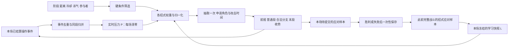

# Boss 战斗决策工程规格 v1.0

日期：2026-11-12。范围：第二步的量化补全与离线验证。**尚未进入第三步完整分层状态机图，也未修改 UE 蓝图。**

这是本项目的复刻规则，不是宣称还原了原作源码。用户已确认的招式、阶段、无闪避无敌帧、仅破防回气等规则为硬约束；下述数值、采样、概率、时序、生命预算和边界处理为可修改的设计默认值。研究证据见上一级《逆天者动态压力与出招机制调研》。MOD 作者报告的压力基础分值仅作为设计起点，半衰期、上限、公式、学习算法均为本项目补全。

## 1. 两条独立的数据通路

- `P` 表示**玩家受到的战斗压力**。正数表示玩家近期应对不利，Boss 更倾向积极进攻和复杂连段；负数表示玩家压住了敌人，Boss 更保守。不能把正数理解为“Boss 被打得更惨”。
- 压力输入只有本场玩家操作的已结算结果。玩家生命、Boss 生命、历史失败次数、跨场成功率、距离、帧率、原始按键数均不直接加减压力。
- `L` 只来自之前已完成的战斗，本场从开始到结束冻结；本场收集的新样本不实时修改 `L`。本场表现可改变 `P`，因此两者不会同时对同一次失误立刻加权。
- 距离、生命、双方杀气、动作时机仍能决定合法招式与局部策略，归入环境条件，不偷偷折算成压力。
- 一次战斗指从开战到玩家胜利或死亡的完整尝试，跨 M1–M4 不清空压力、不提交学习。重试时压力清零。退出、读档、中断调试按 Abort，丢弃本场学习。

## 2. 时间、事件和结算顺序

全部时间用游戏线程上的单调“战斗逻辑秒”，单位秒；距离为 UE 厘米。暂停、切出暂停、纯过场期间不推进战斗时钟，压力衰减、冷却、破防恢复都一起暂停。禁止分别使用墙钟和动画帧数。

每帧固定顺序：

1. 收集这一帧所有有效命中；按 `AttackInstanceID + BeatIndex + TargetID` 去重，多碰撞盒不重复伤害。
2. 在帧开始的阶段／存活快照上结算整批生命、杀气、冲击值；同帧伤害不由回调先后决定谁先死。攻击结果事件稍后按同一批次归并。
3. 判死亡／阶段；阶段纪元 `Epoch` 递增，撤销旧动作、阵法、预约和角色锁；过期回调拒收。
4. 非终局时处理破防、坠地和全阵打断；更新到期恢复；本帧已死亡者不能被吸血／输血救活。
5. 更新实时压力和本场学习缓冲；处理生命服务、可取消防御；角色空闲时才做新的攻击／移动决策。
6. 动作事件推进、预订命中、收势、释放锁。每个分支只结算一次，不能依赖重复 Tick 重新抽签。

同一击出现“命中+破防+抓取”，压力只取 `抓取 > 破防 > 命中 > 普通格挡 > 精准拼刀 > 精准闪避 > 成功闪避` 的一个最终结果。玩家自己攻击的命中／落空是独立事件。若同一拍的多个投射物同时覆盖玩家，伤害可按招式配置，压力与学习仍按一拍一个结果，避免采样由碰撞数量膨胀。

`BattleID / Epoch / ActionID / BeatID` 组成因果标识。Boss 群共用一个压力对象，不能由大师兄、弟子、红衣各自重复上报玩家同一击。已结算的事件永不再次记分；落空必须等攻击有效窗结束且未命中才产生，不能在后续命中后再保留一次落空。

## 3. 本场实时压力：完整公式

事件前按距上次更新的逻辑时间衰减：

`P_decay = P_old × 2^(−Δt / 12)`。

| 玩家已结算行为 | 原始变化 |
|---|---:|
| 普通／蓝光攻击精准拼刀成功 | −12 |
| 精准闪避／正确鬼步判定成功 | −8 |
| 有效威胁下普通闪避成功 | −5 |
| 玩家攻击实际命中敌人 | −1 |
| 玩家普通格挡敌人攻击 | +2 |
| 玩家完整攻击落空 | +3 |
| 被命中且没有成功防御 | +30 |
| 玩家被破防 | +40 |
| 玩家被抓取 | +45 |

对滚动区间 `(t−2, t]` 分别累计已经应用的正、负变化绝对值，正预算 60，负预算 30：

`δ = sign(w) × min(|w|, max(0, B_sign − Used_sign))`

`P_new = clamp(P_decay + δ, −100, 100)`。

正负预算分开，失败后仍能凭正确反应降低压力；预算记“被允许应用的变化”，不是最后因 ±100 截断后的净差，避免顶格时无限积攒有效事件。每次决策前先衰减，事件到来时也先衰减。没有输入时自然趋近 0，**这不是杀气回复**。

APM、乱按、原地空闪避没有直接收益；闪避成功必须关联一条原本会覆盖玩家的有效威胁。普通攻击被敌人格挡：本版不算“命中敌人生命”的 −1，也不算落空 +3，压力 0。命中多敌人的一次范围攻击只记一次 −1；每个独立挥击可单独统计但仍受滚动预算限制。

例：t=0 被抓 +45、另一击命中 +15，随后命中因预算耗尽 +0；连续三次精准拼刀分别 −12/−12/−6，压力变 30；后续 12 秒无事件则变 15。不存在每秒自动根据血量提升压力。

## 4. 跨战学习：各招式独立、有限记忆

### 4.1 样本与归因

每个规范招式 ID 一份证据，别名不另开样本：M1-06 合并 M1-04，M2-02 合并 M2-01-F，R-06 合并 R-04。未确认／禁用招式不采样。大师兄 M2/M3/M4 继承招式共用招式 ID 的经验，M4-01 独立。

- 成功拼刀／有效闪避／玩家主动打断：应对分 `s=1`。
- 普通格挡：部分成功 `s=0.65`；命中／破防／抓取 `s=0`。这是带部分分的应对率，不把普通格挡冒充完全成功。
- 每个根招式实例只提交一个根样本：有效已执行拍的 `s` 平均值。整套七连不会天然提供七倍根证据。玩家在有效交战中主动打断整套未完成招式，提交根成功 1；已经结算的伤害结果仍用于压力，根学习的这一规则专门奖励成功中断策略。
- 行政取消（阶段变更、调试、目标失效）、玩家已死亡后、未展示且未执行的段、无威胁的隔墙／距离失败不记样本。纯未命中的 Boss 招式只有确实建立过对玩家的有效威胁且玩家通过走位躲开，才记成功，否则记“无样本”。
- 红蓝黑同时攻击作为联合威胁时，若归因为唯一共享应对窗口，只给联合根 ID 一个样本；不得把一次被困后的伤害当成两名 Boss 的两次独立失误。M3-02 两个时间分离的拍可各评结果、再平均成一个联合根样本。
- 另有条件学习键 `M2-05-F/blue`，只在追加蓝刺真实执行时记该拍应对；`M2-01-C/length/n` 只在 n 段前缀实际执行完整时记前缀平均；E 对应普通串完整执行时记录 `M2-01-E/length/n`。根键与条件键分别用于根选择与分支，禁止用同一键同时乘两次。
- 第一版不学习“未选择的反事实分支”、玩家输入序列或玩家身份画像。不会因玩家从未见过某招就推断其不会应对。

### 4.2 后验、置信度、权重

存储成功证据 `S_i` 和失败证据 `F_i`，允许小数。战斗开始复制不可变快照：

`n_i = S_i + F_i`

`r_i = (2 + S_i) / (4 + n_i)`　（Beta(2,2) 先验）

`c_i = n_i / (n_i + 8)`

`L_i = exp[1.2 × c_i × (1 − 2r_i)]`。

应对越差，下一场该招权重越高；应对越好，该招权重越低。没有样本 `L=1`。理论界限 `e^(−1.2)..e^1.2`，实际因证据封顶更窄；即使完全掌握也不能把招式彻底删除。

战斗结束，对每个键，本场有 m 个样本时 `a=min(1,6/m)`；m=0 令 a=0：

`S_tmp = 0.9S_old + aΣs`；`F_tmp = 0.9F_old + aΣ(1−s)`。

若两者之和 >40，按相同比例缩放到40。每个键每场最多贡献6个等效样本；旧证据每个有效完整战斗衰减10%，未遇见的招式也衰减，防止早期习惯永久锁死。胜负使用同样更新规则，不另设“输了就加难”倍率。

保存 `{SchemaVersion, PlayerSlot, EncounterID, S/F by MoveID, LastCommittedBattleID}`；事务写临时文件再替换／UE SaveGame 完成后确认。战斗结算 ID 必须幂等；崩溃读到不完整存档退回最后完整版本，未知新增 ID 使用先验，别名合并需版本迁移。参考模型使用内存集合做幂等测试，UE 落地采用持久化事务 ID，不能把无限增长的测试集合原样放进长期存档。

## 5. 每个招式的实际出招率

### 5.1 合法集合

硬条件先于所有概率：当前阶段包含该招、执行者存活且可行动、距离在招式上限内、有视线、杀气状态允许、冷却结束、所需参阵者可用、角色锁可申请。形态动作共享一个执行者，不能因有两个技能就重叠执行两个身体动作。

M1 阵法需要大师兄可行动及至少2名合格弟子；M1-09需要完整6弟子。人数统计区分存活人数、可参阵人数、当前预约人数。M2-05近版 `d≤450`，远版 `450<d≤1800`，共享同一冷却，预警后不变色。M3 两名 Boss 用各自距离；联合招以两者距离较大者检验范围，且双方都可行动。

连续两次相同根招禁止第三次；连续两次“危险候选根招”禁止第三次危险候选。危险候选含一切可能有红／蓝／黑的根招，**远距无光喷射也算危险候选**，因为它可能追加蓝光；不会通过无光起手绕过限制。计数按实际开始的动作，打断不退款、不清除历史。移动、等待和生命服务不清除攻击历史；必须等一个合法普通根招开始才能断开危险连发。阶段变更清历史与等待年龄，继承技能的冷却保留。

### 5.2 权重和条件概率

对每个合法招式 i：

`x=clamp(P/100,−1,1)`

`D_i=0.25+0.75 exp[−0.5((d_i−μ_i)/σ_i)^2]`

`R_i=0.7^(近4次中i出现次数) × (上一次是i ? 0.25 : 1)`

`A_i=1+0.04 min(连续合法但未选中的决策次数,10)`

`C_i=(玩家杀气<25%且i危险 ? 1.15 : 1) × (玩家已进入可观测收势窗口且i前摇≤0.7秒 ? 1.2 : 1)`

`w_i = b_i × exp(k_i x) × L_i × D_i × R_i × A_i × C_i`。

`b,k,μ,σ` 按附表逐招配置。环境条件必须来自已展示动作及已知资源，不读玩家未来按键；“收势窗口”也不能允许 Boss 跳过自身前摇。等待年龄只在该次选择合法的候选里累加，非法期间不积累。

先归一化并加12%探索：`u_i=0.88 w_i/Σw + 0.12/N`。再执行“封顶后按比例再分配剩余质量”的 water-filling：N≥3时每招≤45%；N=2时≤65%；N=1时唯一合法招100%；N=0不抽签、不除零。只把溢出质量分给未达上限的项，循环最多 N 次。所得 `q_i` 是“已决定进攻后的招式条件概率”，不是每帧出招概率。

### 5.3 进攻频率与最终概率

空闲决策每0.2秒最多一次；选到移动后至少执行0.6秒才可再作普通决策，攻击全程不重复根选择。攻击结束留0.2秒全局重入间隔。

`O(P)=clamp(0.70+0.18x,0.52,0.88)`。

自上一次进攻开始已满3秒，且存在合法攻击，令 O=1，避免抽到连续对峙而永久不出手；没有合法攻击时 O=0，不强制越距攻击。3秒规则只对“空闲时的下一次选择”生效，不打断正在收势／破防／坠地的动作。

不含确定性服务／开场事件时：

`Pr(选择根招i)=O(P) q_i`

`Pr(开始i及预选方案z)=O(P) q_i π_i(z) I(角色锁和时间预约可成功)`。

z 是已选的前缀长度、演员组合等预选方案。预约成功 I 为确定的0或1；若方案有多个 z，总开始率是对 z 求和。预约失败本次进入等待，不在同帧不断重抽，剩余概率归入不攻击。执行到分支后再按该时刻条件概率选择，完整路径概率为**根选择率 × 预选概率 × 各实际经过节点的条件概率 × 所有必要合法性指示**。不能把招式表中的 base=18 写成“18%出招率”。

开场 M1-04、召唤、吸血、红衣输血、死亡演出走优先级服务，不混进随机池；满足且成功占用时它们的选择概率为1，其他根招为0。固定开场只触发一次；若被中断直接进入常规战斗，不循环补播。开场也受参阵人数与角色条件限制。

### 5.4 防饥饿与可解释性

探索保证每个当时合法招式有正概率，等待年龄再加权，但**不保证某招在固定 N 次内必出**。在持续合法且每次进入攻击选择的条件下，未被选中 K 次的概率至多 `(1−0.12/Nmax)^K`；冷却、硬门槛、预约失败会降低可用次数，不能套用无条件保证。当前不设置强制轮流出招，以保留不可预测性。

逐次记录候选过滤原因、每项权重、q、O、随机数、预约结果、分支节点及样本归因。调试面板显示“条件率”和“本次开始率”两列，避免只看随机统计误判失效。

## 6. 出招池、变招与颜色约束

原子：L左横劈、R右横劈、U上挑、D下劈、T前刺、J跳劈、K鞭腿、Q剑气／普通投射。前缀 `B:`蓝、`R:`红、`K:`黑；无前缀均无光，K本身是腿法不是黑光。

| 根招 | 模板与允许分支 |
|---|---|
| M2-01-A | L→R→U→D→蓝突刺，最多5拍 |
| M2-01-B | L→R→蓝突刺，最多3拍 |
| M2-01-C | 1–4拍普通前缀→完整B，最多7拍 |
| M2-01-D | 前刺→前刺→蓝前刺，最多3拍 |
| M2-01-E | 1–4拍普通招，无蓝收尾 |
| M2-01-F | 独立蓝光突刺，不再派生 |
| M2-03 | 4拍高空追踪丝线，无光 |
| M2-04 | 拉远准备→红光远程攻击；拉远不可达则结束准备，不强行瞬移 |
| M2-05近 | 红光扇形丝线喷射，结束；禁止蓝光追加 |
| M2-05远 | 无光扇形丝线喷射→结束或蓝光突刺；追加后结束 |
| M3-01 | 两人联合蓝光，一个协调后的共同应对窗口 |
| M3-02 | 大师兄红光→红衣红光，间隔0.85秒，两个可分别应对的窗口 |
| M4-01 | 6刀，前5普通，第6蓝光**斩击**；不沿用M2“蓝必突刺”的限定 |

普通前缀转移表：L→{R,U,T}；R→{L,D,T}；U→{D,R,T}；D→{U,L,T}；T→{L,R,D}。首段五选一，后续合法边等概率1/3。仅普通可变前缀内部使用该表，C接B时允许模板边，D保留明确的两次连续刺。每个转移都有段间连接动作，逻辑标记为0.18秒，包含在段间间隔内，不额外增加伤害拍。

长度 n∈{1,2,3,4}：`v_n=exp[0.4x(n−2.5)] × L_(根/length/n)`；用同样12%探索，长度概率上限55%，归一化。中立未学习时每种长度25%；高压力偏长，低压力偏短。

A/B/C/D 只在**第2个普通拍结算之后**允许一次停招：

`p_stop=clamp(0.12−0.06x+0.18 I(上一拍被拼刀或成功闪避),0.06,0.36)`。

停招直接收势；未停招则以 `p_observe=clamp(0.12+0.08x,0.04,0.20)` 插入一次0.35秒观察；观察结束执行已选剩余序列，不回到根池、不再递归观察。观察期间允许登记威胁、取消／受击中断，**不会在本版重新抽另一个根招**。此版的变招包含模板选型、前缀长度、有限停招、节奏停顿及喷射蓝刺追加，未实现任意帧跳招。

远喷射第一拍结算后：

`p_blue=clamp(sigmoid(−0.15+0.65x+h+ln L_(M2-05-F/blue)),0.15,0.80)`。

其中上拍命中 h=.45、普通格挡 .10、精准拼刀 −.55、普通闪避 −.35、精准闪避 −.45、落空 −.35；未知／无交互0。只读已经结算的上一拍。近距红版不计算此概率。追加蓝刺开始前仍须复查存活、角色、距离≤1100、视线；不满足时合法结束并不采样未执行蓝刺。预约准备阶段必须预留“可能追加”的时间，不能等玩家已经看到两个冲突预警才临时加攻击。

所有末段之后只能进收势／被打断／死亡，不回跳同一招的开头；蓝段后不能再接普通段；观测与停招各最多一次；任何模板≤7伤害拍，M4固定6。无递归拼接，无“再随机一套”边。大师兄所有阶段无黑光；M1无黑光。

## 7. M1 阵法、演员和生命服务

### 7.1 普通出手与支援

普通近战使用全阵一个令牌：一次一人，或一个事先声明的双人组合。M1-01每行当前为单人原子；无光三拍阵中每拍是预定义双人组，不能从普通原子随机多生成两份碰撞。普通招式之间回到0.18秒过渡＋收势，再申请令牌；M1不另加无上限的普通连招。

可出手演员按 `a_j=(1+0.1 min(等待轮数,10)) × exp[−0.5((距离−招式理想距离)/宽度)^2]` 归一化抽取，至少1e−6防数值下溢。先排除死亡、破防、参阵预约、脱阵冷却、不可行动角色；大师兄可参与普通近战，但阵法需要他空闲。选定演员后用其实际距离复查根招。双人组的身份是动作数据的一部分，禁止两个独立根选择碰巧一起攻击。

一名破防弟子取得脱阵槽直到杀气回满；第二人仍正常破防但不能取得第二槽。槽位不是攻击许可证：脱阵者可以移动、挨打、破防结束后申请普通出手，仍受总令牌。连续3秒内玩家有效命中同一脱阵弟子≥3次触发支援请求，冷却4秒。现有攻击完成／合法中断之后，下一次普通近战优先给距玩家最近的可行动同伴；没有合法同伴则等待最多2秒后丢弃，不抢占不可取消段。支援攻击使用可用M1普通招的相同权重公式重新归一化，禁借支援名义发额外阵法。

大师兄普通剑气 M1-01-Q不占普通近战密度令牌，冷却4秒。只在大师兄自身空闲且不在阵法／服务中、已有主近战动作时额外尝试一次：`O_wave=clamp(0.18+0.10x,0.08,0.28)`；对应通道只有这一招，因此条件招式率为1。失败等到下次主动作，不逐帧掷骰。它可以与弟子近战并行，仍必须接受命中时间安全预约。不能让大师兄一边吸血一边再播放另一套剑气身体动画。阵法内指定剑气已经包含在该阵法，无额外叠加Q。

### 7.2 归阵与剑阵

参阵名单在归阵启动时冻结：从存活、非破防、非脱阵、未被其他动作占用的弟子按稳定 ActorID 顺序取全部可用者；大师兄必选。参与者两两最大距离≤700cm，归阵为回旋跳0.6秒；否则丝线弹跳1.3秒。投影到可导航且可落地的阵型位置，位置无效则该次归阵失败，0.5秒后回到普通决策，不反复瞬移重试。预订最长归阵预算，归阵不造成伤害、没有无敌帧。

| 参与弟子数 | M1-03逻辑阵型 | 大师兄借力次数 |
|---:|---|---:|
| 2 | 双人短阶 | 1 |
| 3 | 三点三角阶 | 2 |
| 4 | 双排折线阶 | 3 |
| 5 | 扇形五点阶 | 4 |
| 6 | 完整六点阶 | 5 |

阵型名称／坐标样式与借力映射为本版补全，不声称来自原作数据；借力每次增加0.22秒准备、最后必为蓝光突刺。M1-02最后必蓝；M1-04红且与开场M1-06同一动作。

M1-07用大师兄普通剑气开头，随后当前参阵弟子轮流斩击，最后一名弟子蓝光；总拍数=弟子数+1，满员7拍。弟子出场顺序按冻结名单，不能死亡后跳进新的弟子改变末段颜色。M1-09仅满6弟子：第一对跳劈→第二对跳劈→第三对与大师兄同时剑气，共3拍普通攻击。

任何**当前参阵者**真正被打断，整个归阵／剑阵取消，未来伤害预约清除，所有参与者进入0.8秒阵法中断收势，各自已有破防／坠地／死亡优先。仅普通受伤但抗打断成功不自动全阵取消。未参阵脱阵弟子的受击不影响剑阵。人数变化后下一次再重新选阵，不在正在执行的阵里热替换成员。阵法全程持有主令牌，因此不额外发动支援近战。

### 7.3 吸血和召唤：按总血量守恒检查

默认 M1大师兄最大生命3000、初始6弟子各350；M2大师兄4000，红衣1800。数值为逻辑演示默认，可统一倍率缩放，阈值比例不变。

- 存活弟子<3且大师兄当前生命 **>1000**：召唤优先，补至3；总费用1000，冷却18秒，前摇1.0秒、收势0.6秒。等于1000禁止召唤。
- 为防召唤后吸血凭空创造总血量，新弟子每人初始生命 `min(350,0.8×1000/本次缺员数)`；补1名350、2名各350、3名各266.6667。浮点保留到结算，不因显示四舍五入超预算。每次新生总血≤800，总战斗血量至少减少200，**不设置召唤次数上限**。
- 大师兄生命<2250且有弟子可转移生命：吸当前**绝对生命最高**弟子（并列按ActorID），允许脱阵者。转移量 `min(450,3000−大师兄HP,目标HP−1)`，等量扣弟子加大师兄，冷却12秒，前摇0.9秒、收势0.5秒。
- 同时合法先召唤。召唤完成后三秒内禁止吸血，避免新召唤即秒吸；费用不足但有合法吸血对象时允许先吸。吸血不会自然生成血、不会把弟子吸死。
- 服务意图选定后在前摇结束时复查、**一次原子提交费用与收益**。开始即消耗完整冷却，前摇中断不退冷却；若目标失效则整次作废，不悄悄换目标。吸血冷却不因“条件不成立”逐帧重设。服务不得抢占已承诺的不可取消攻击段。
- 参考 `HealthServices.perform()` 合并了合法检查与提交，验证的是资源数学；UE需要按上述意图／前摇／复查拆开。

令 E=大师兄HP+所有弟子HP，则玩家伤害使E下降、吸血使E不变、召唤使E至少下降200。初始E=5100，不存在无外部治疗的无限召唤／吸血增益循环；召唤总数粗上界25次，实际受费用、人数、伤害影响更少。没有依靠“强行最多召三次”掩盖资源漏洞。

## 8. M3 双人协调与红衣输血

M3主通道池含继承的大师兄招、红衣独立招、联合招。双方各一把角色锁；联合招原子获取两把，失败不部分持有。普通主招仅占自己的角色，但全局主决策要等本次主动作完成才开始下一根。

大师兄执行非联合主招时，红衣最多申请一次副通道，仅允许R-01/R-02普通招：`O_secondary=clamp(0.10+0.15x,0.02,0.25)`，剩余合法两招用相同权重公式归一化；冷却按角色与技能共用，攻击历史使用场景共享记录，不可按主、副通道各开一套。主招是红衣时大师兄本版不额外开启副通道；主招是联合招时副通道关闭。这样大师兄坠地时红衣仍能由主池独立进攻，红衣被打断时大师兄也不会被错误冻结。

红衣输血：仅M3、双方活着、大师兄<40%最大生命、红衣>25%最大生命、冷却已到；转移 `min(300,大师兄缺血,红衣HP−1)`，双方总血不变，冷却20秒，前摇1.2、收势0.6秒。占双方锁，受击按强度可中断；前摇结束批次在死亡判定之后提交，不能复活。开始即冷却；输血打断不退。红衣生命不因治疗低于1；殉情只由大师兄先死亡触发，不由输血支付意外触发。

### 全局攻击时间预约

不同根动作的有效命中时刻：普通对普通至少0.35秒；任一红／蓝／黑时至少0.65秒。所有攻击通道（含独立剑气、支援、副通道）都检查。联合招／剑阵同一拍是设计为共同应对的一个根窗口，不能用“同动作ID”随意豁免无关攻击。

招式首拍时间=`启动+归阵时间+前摇+借力时间`；后续普通拍间隔0.50秒，彩色拍间隔0.85秒；观察暂停额外0.35秒。有效窗0.18秒；最后有效窗结束后进配置收势。彩色段至少预警0.65秒，实际首段前摇见表；M2-04拉远额外准备最多1.2秒，不能挤掉预警。

在**发出任何攻击预警之前**预留全部可能未来时刻的并集：有／无观察、远喷射可能追加蓝刺都计入；选定前缀长度后只需要该长度。申请时允许整体启动推迟0..1秒，步长0.05秒，最多21次检查；失败等待0.5秒再决策，不能移动已经播放的预警来救排程。根动作结束或取消时释放未使用预约。中途选定分支可删除不再可能的预约，保留不用的预约也只导致保守等待，不产生冲突。

时间预约与角色锁在同一游戏线程事务获取，任一失败回滚全部；不存在持有大师兄锁等红衣、同时红衣等大师兄的死锁。锁存租期=动作最长路径+允许准备/启动延期+1秒容错；超时回收并回到安全恢复，旧动作回调由ActionID/Epoch挡住。攻击时刻偏离已预约计划超0.1秒，取消这次尚未执行的攻击段，不赶帧补齐所有伤害。

## 9. 通用防御、移动、受击和资源

以下为第三步需展开的行为契约，本轮不把它们误写成随机攻击招式。

| 行为 | 进入条件／内容 | 退出与限制 |
|---|---|---|
| 对峙 | 无服务、无合法攻击或本次未进攻；面向玩家 | 0.6秒后再决策；满3秒有合法攻击则必选进攻 |
| 追赶 | 距离>650时偏好；沿导航缩短到目标招式理想距离 | 每段0.6–1.2秒；1.2秒无距离改善≥50cm判路径失败，冷却1秒后重试 |
| 侧移 | 可导航方向中移动，避免重叠 | 0.6秒；不自行生成绕背攻击令牌 |
| 后撤 | 拉开距离，低自身杀气提升权重 | 0.6–1秒；不得以此回气；M2-04准备后撤最多1.2秒 |
| 主动格挡 | 已感知攻击、正面±60°、可取消窗口、杀气>0且非破防 | 感知延迟0.18秒后再复查；能挡的威胁优先格挡，0.25秒格挡动作，连续命中可重播但不可压过破防／死亡 |
| 闪避 | 威胁已展示、可取消、无合法优先格挡、闪避冷却到且有可达位移 | 概率 `clamp(0.2+0.35(1−自身杀气比)−0.1x,0.1,0.6)`；0.55秒移动250cm，冷却2.5秒；**全程无无敌帧** |
| 普通受击 | 实际命中，按伤害扣HP与冲击；超过动作抗打断值才取消 | 轻硬直0.35、重硬直0.6秒；未中断则原动作继续；硬直期间连续轻击不重复延长末时刻 |
| 破防 | 杀气降到0，打断当前可受中断动作，禁止格挡 | 大师兄4秒、红衣3.5秒、弟子3秒线性回满才解除；起始硬直结束不等于解除 |
| M2/M3/M4坠地 | 大师兄2秒窗口内冲击值≥100 | 坠地2.8秒后重悬；之后3秒内不再次坠地，仍承受伤害与杀气损失 |
| 悬吊破防静止 | 大师兄破防且当前不处于坠地 | 原地静止直到杀气回满；与坠地是两个状态维度 |
| 阵法中断 | 任一当前参与者被中断 | 全体未来阵攻击撤销，0.8秒恢复；个体死亡／破防优先 |

不进攻时移动权重：追赶=`3 if d>650 else .5`，后撤=`1+2 I(自身杀气<30%)`，侧移2，对峙2；按比例归一化、单项上限65%。移动时长在列出的区间内均匀抽样，每次进入只抽一次。路径不存在不强行穿墙，回到面向等待，1秒后再检查；永久不可达的玩家不保证Boss能攻击到，不能把正常等待当“死循环修复”为越距伤害。防御决策按ThreatID只反应一次，不能对同一个已感知威胁每帧重抽闪避概率。

默认杀气满值100。玩家轻／重／蓄力打击对格挡的杀气损失12/24/40；普通命中损失6/12/20；冲击值10/25/50。按攻击数据设置强度1/2/3，默认普通准备和收势抗打断0、已承诺普通攻击段1、彩色有效段2；达到或超过阈值且伤害有效则中断（招架成功不算受到HP命中）。破防时一律可中断，伤害倍率1.25，但不能重复重启破防恢复计时。彩色不等于绝对霸体，阵法成员符合中断条件时仍全阵取消。

每个动作的可主动取消窗口：前摇最初40%、普通段间0.18秒连接、收势最后40%；彩色预警已承诺后的阶段和所有有效窗不允许AI主动取消成格挡／闪避。受击强制中断、死亡、阶段转换不受主动取消窗口限制。格挡对背后、不可格挡特殊攻击、鬼步后的特殊攻击无效。

杀气只有破防后线性恢复：`Qi(t)=QiMax × clamp((t−BreakStart)/BreakDuration,0,1)`。其他状态绝不加杀气。恢复未满时即使数值已>0，仍禁止格挡。破防中继续受击扣生命，但不再扣正在恢复的杀气或重置计时，避免无限破防；完成恢复的同帧可以再被后续新攻击破防，但这是新事件，不是旧回调复触发。

坠地与破防同时满足时先表现坠地，破防时钟继续；2.8秒后如果仍未回满，转为悬吊静止。仅大师兄悬吊形态使用“坠地”；其他角色普通受击不套用该演出。

## 10. 阶段、死亡与终局优先级

1. M1大师兄生命耗尽：撤销全部弟子动作与剑阵，结束剑阵阶段；进入M2并建立新的4000生命池。旧阶段溢出伤害不穿透新生命池，旧阶段攻击回调全部失效。这是阶段换生命池规则，不是闪避无敌帧。
2. M2大师兄生命≤50%：一次性锁存红衣加入，进入M3。之后治疗超过50%不回M2。原M2技能冷却保留。
3. 一击从M2半血上方直接打死：仍记录红衣进入触发，再立即按大师兄先死走殉情结束；不凭空补1HP、不提供未声明的到场无敌。因极端伤害可以跳过实际双人交手，不强制延长战斗。此边界是设计选择，若展示必须完整走四阶段应调演示伤害，而不是隐藏改伤害。
4. M3红衣先死且大师兄存活：进入M4，保留大师兄当前HP／杀气，增加六刀技能；旧联合动作撤销。
5. M3大师兄先死且红衣活：红衣逻辑进入殉情，立即停止战斗AI和伤害，最多2秒殉情演出后终局；参考模型将演出折叠为同事务终局，红衣逻辑HP清零。
6. M3同一伤害批次双方死亡：双亡终局；不进入狂暴或重复殉情。M4大师兄死：终局。
7. 玩家同帧也死：本版以玩家存活为胜利条件，因此记录失败；Boss阶段／死亡事件仍可播放，但只能提交一次战斗结果。先锁存 `BattleResolved`，禁止任何后续治疗、召唤或选招。

所有阶段变更清理：动作令牌、未来攻击预约、阵法参与者、脱阵槽、服务意图、过期定时器。压力与本场样本保留到整场结束；跨场样本只结算一次。M1参战弟子在进入M2时注销；演出残影不能继续报告伤害或学习事件。

## 11. 有界性、漏洞防线与落实接口

| 风险 | 约束与恢复 |
|---|---|
| 所有权重0／NaN | 合法招式权重必须正且有限；非法配置加载失败，不进入随机选择 |
| 全冷却／超距／无视线 | 空集合走移动／等待，至少0.5秒后再试；不while抽到合法为止 |
| 长连段无限拼接 | ≤7拍、每分支一次、结束只去收势，观察最多0.35秒 |
| 停招再选同招刷起手 | 启动消耗冷却＋重复惩罚＋禁止三连根招 |
| 危险招无光起手规避限制 | 远喷射按“可能带蓝”的危险候选计数 |
| 副通道绕过角色冷却 | 同一个Actor/Move共用冷却，所有通道共用日历 |
| 预留时没蓝光、执行时突然蓝光 | 起手预约可能分支时刻的并集 |
| 反复召唤吸血增加总血 | 召唤新血≤费用80%，吸血守恒，死亡先结算 |
| 红衣给死亡大师兄输血 | 伤害批次、死亡判定先于治疗提交；终局不可逆 |
| 重复回调／过期动画通知 | 四级ID、单次Beat标记、Epoch验证 |
| 双人互等死锁 | 原子多锁申请、失败整体回滚、有租期 |
| 反复受击永久延迟破防恢复 | 破防回满时刻不被重击刷新，普通硬直不重复延长 |
| 一次失败永久偏置选招 | 先验、置信度、每场证据限6、总证据限40、历史衰减、探索与封顶 |

Actor接口建议：`CanAct / PerceivedThreat / CurrentHP / Qi / IsBroken / InterruptStrength / DistanceToTarget / HasLOS`；服务接口：`TryReserveAction / ReleaseAction / ReportBeatOutcome / RequestPhaseChange`；配置：招式表、原子转移表、压力常量、学习常量、阶段阈值。所有接口保持纯逻辑，Actor、动画、碰撞资源引用暂空。

下一步HFSM可以把阶段层、角色表现层、有限招式执行层与中央调度器展开在同一蓝图页面；压力和学习是状态转换的输入，不应伪装成彼此跳转的数百个“高压/低压×每招”状态。具体节点与连线在第三步验收时展开，本文件先固定算法和守卫条件。

## 12. 可执行参考与验证边界

- `catalog.py / move_catalog.json`：33个启用根招，别名、禁用项、所有参数的单一数据源。
- `policy.py`：压力、学习、概率、前缀、节点决策、攻击日历、角色锁、杀气、阶段及生命守恒参考。
- `verify.py`：边界断言、随机上下文、抽样统计、合成玩家会话、跨场学习、日历及并发锁压力测试。
- `逐招参数与概率表.md / probability_scenarios.csv / 概率检查器.html`：全招式参数与给定上下文实际概率。
- `模拟与核对报告.md`：实际运行数字、发现与修复的问题、仍需实机验证的内容。

参考 Python 不等于完整 UE 战斗系统：角色感知、位移导航、攻击命中归因、服务前摇、帧内玩家与Boss同死优先级、动画通知与视觉共同应对窗口，是本文件已规定、下一步需要逐项实现和验证的集成契约。测试覆盖范围必须与报告一致，不能以离线0断言失败宣称没有任何潜在Bug。
