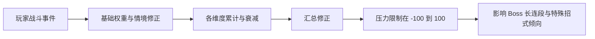

# 第二步：逆天者动态压力与出招机制调研

日期：2026-11-11。第一步已验收；本报告提交第二步验收，尚未进入第三步状态机设计或 UE 实现。

前置规则：[第一步验收规则](../Step1/第一步验收规则.md)。已确定本项目 Boss／弟子闪避无无敌帧，只有破防后回气；本报告中的压力变化不得改写这些规则。

## 1. 核心结论

1. **逆天者确有动态出招设计。** 开发者采访明确描述佯攻、连招中途停下观察、根据玩家反应再追击，以及根据上一击是否命中选择后续动作。这里的“动态”至少包含即时局势判断和命中结果分支。[T1、T2]
2. **找到了压力值的具体社区解包线索，而且已追到作者本人。** B 站 MOD 作者“无事生风-”在自己视频的置顶评论中披露 −100～100 的压力范围及九项基础权重，说明压力来自玩家战斗处境和表现，高压力提高长连段／特殊招式出现倾向。[T3]
3. **压力方向应理解为玩家受压程度。** 按作者描述，玩家被打、被破防、被抓取增加压力，精防／成功闪避／攻击命中降低压力；高压力下 Boss 更凶，低压力下更保守。不能理解为“玩家越强，系统越自动加难”。[T3]
4. **没有证据证明原作必须统计红蓝光成功率、APM 或长期玩家画像。** 事件累计、衰减，加上当前局势和合法招式分支，已经可以产生“像在学习玩家”的表现。是否另有逐招成功率、习惯识别、跨局记忆，目前未知。[T1～T4]
5. **不能把公开的基础权重直接当成完整原版公式。** 作者明确提到情境修正、各维度累计与衰减、汇总修正；没有公开原始资产、完整调用路径、衰减系数、分档阈值及每个 Boss 的选招表。本次未自行解包、未运行该 MOD、未做同版本战斗采样。[T3]
6. **“不读指令”是开发者明确的设计陈述，不是本次代码审计结论。** 官方采访否认使用输入读取；社区另有“空药按键／乱按会涨压力”的未验证说法，二者存在待核对边界。不能把评论当成推翻采访的技术证明，也不能把采访当作所有版本的程序验证。[T1、T3]

## 2. 证据等级与已核实的出处

| 等级 | 本次定义 | 实际获得的内容 |
|---|---|---|
| A | 开发者采访原文中的陈述 | AUTOMATON 日文联合采访正文；说明逆天者与 66 天相同难度、佯攻、停顿观察、否认读输入 |
| B | 媒体对采访的明确转述或攻略记载 | GamesRadar 转引 PC Gamer Magazine；Game8 攻略的游民转载。证明报道了什么，不证明算法全部实现细节 |
| C | MOD 作者的直接披露或社区观察 | 作者本人置顶压力说明、其跟帖；游研社社区用户文章。没有取得原始解包配置，不能升级为已验证原版数据 |
| U | 未公开／未完成独立验证 | 完整公式、逐 Boss 阈值、隐藏状态、原版分档、跨局保存、神经网络／在线训练 |
| D | 建议用于本项目的后续设计方向 | 明确与原作事实分开，待第二步验收后在第三步确定 |

### 2.1 开发者说了什么

**T1，AUTOMATON，2026-10-09，Soulframe 联合采访：**

- 逆天者以对真人 PvP 的感觉为目标：佯攻诱使玩家挥招；连招打到一半停下来，观察反应后再追击。
- 原文明确说制作中没有采用「入力読み」（读取输入）。
- “66 日”与逆天者难度相同，只额外限制死亡次数。
- 简单难度的区别主要体现为敌人攻击欲望与反应速度，并非只改数值。**这是难度档位差异，不足以证明单局压力也会动态改变反应速度。**
- 问题中虽然用了“学习攻击模式”，回答没有披露训练算法、统计表或神经网络。不能把提问中的假设当成回答确认的技术细节。

**T2，GamesRadar，2025-09-21，转引 PC Gamer Magazine 的梁其伟采访：**

- 用荒行子举例：判断局势对自己有利还是不利，选择不同攻击。
- 所谓 “lucky draw” 状态中，命中则继续连招，没命中则采取其他行动。
- 本次已读取 GamesRadar 正文，但未取得所引纸刊全文；AUTOMATON 2025-09-22 与 17173 2025-09-22 的报道属于同源转述，不能算三份独立验证。
- 示例对象是荒行子，不能据此声称大师兄每个派生点都已被证实使用相同规则。

### 2.2 压力资料追溯结果

搜索先找到贴吧、NGA 的转帖摘要，随后追到 B 站视频 **BV1rsxU66EYZ《影之刃零！AI重做，难度mod，真正的高手对决》**。

- 视频作者：无事生风-，UID 352264607。
- 置顶说明作者 UID 与视频作者一致；评论 ID：322873660752。
- 作者表示基础权重来自解包；其跟帖表示 MOD 将压力固定到 100，因而可以看到原来较难出现的连段；另称负压力时会散步并重复部分低威胁招式。
- 本次读取视频元数据、置顶说明及其 5 页公开回复；字幕接口没有返回字幕。**没有观看或逐帧核验 3 分 36 秒 MOD 演示。**
- 尚未获得能复现这些结论的原始数据文件、版本号或原版／MOD 对照日志，因此权重和效果按 C 级作者披露处理。
- 作者另一个“AI 一体重做”的答复不能证明 MOD 只修改压力；不能把所有演示差异都归因于单个变量。

另一份资料 T5 是游研社**社区用户“桃枝”的帖子**，不是游研社编辑部的技术核验。正文从页面内嵌的公开 JSON 读取，描述喝药、破防、普通防御增加压力，精准应对降低压力，压力高时投技概率上升。与作者方向一致，但没有提供完整公式，独立性也未确认。

## 3. 单局压力由哪些战斗事件影响

以下完整九项来自 **T3 作者置顶说明**。表中事件均按玩家视角理解；数值是“基础权重”，不是已经验证的最终压力增量，也不是技能概率或伤害百分比。

| 玩家事件 | 作者披露的基础权重 | 含义与计数边界 |
|---|---:|---|
| 普通精防 | −12 | 成功精准防御降低压力。原文限定“普通精防”，蓝光精防是否同值尚未明确 |
| 完美闪避 | −8 | 成功精准应对降低压力；具体红光／其他攻击分类未知 |
| 普通闪避成功 | −5 | 成功躲开攻击；不能把空放一次闪避也直接计为成功 |
| 攻击命中 | −1 | 玩家进攻取得命中结果；是否包含被敌人格挡、每段／每目标怎样计数未公开 |
| 普通防御 | +2 | 玩家依赖普通格挡承压；与精防是不同结果 |
| 攻击落空 | +3 | 玩家挥空使压力增加；连段内多判定怎样合并未知 |
| 未作出防御反应而受击 | +30 | 原文不是所有受伤统一 +30；失败防御、持续伤害、环境伤害如何分类未知 |
| 被破防 | +40 | **玩家**破防；不是大师兄／弟子破防给玩家加压 |
| 被抓取 | +45 | 玩家被投技命中；不代表所有红光攻击都属于抓取 |

来源声称压力最后限制在 **[−100, 100]**。其披露的过程可概括为：

这是 T3 对机制的文字描述可视化，**不是已取得的原版蓝图或本项目 HFSM 方案**。

尚不能把它简化成已确认的 `P += 权重`，因为以下细节均未知：

- 各维度的名称、上下限及是否相互独立。
- 情境修正是否包含双方血量、杀气、距离、阶段，以及具体函数。
- 衰减是向零回归、向基线回归，还是只衰减某些维度；速度、延迟均未知。
- 初始压力、战斗重开／转阶段／红衣加入时是否重置，以及双 Boss 是否共享一个值。
- 单次抓取同时造成伤害和破防时，+45、+30、+40 是否累加。不能擅自一击算三次。
- 玩家攻击命中同时导致 Boss 坠地／破防，是否存在额外减压事件。

### 3.1 其他可能因素及证据边界

| 因素 | 已有资料支持到哪里 | 结论 |
|---|---|---|
| 喝药 | T5 社区正文称增加压力；没有权重或具体触发时点 | C：可作为候选输入，不能给出原版定值 |
| 空药时按喝药／乱按键 | T3 楼下普通读者留言，非置顶作者披露，无代码／复现 | 低置信线索，不进入已知原版规则 |
| 操作密度／APM | 没找到具体统计窗口、有效按键定义或权重 | U；不等同上述“乱按”的评论，也不必为了适应机制读取原始按键 |
| 玩家进攻欲望 | 命中、落空已进入作者表；没有独立“进攻欲望”字段证据 | 可由结果间接体现；持续贴近／主动抢招比例为 D 级统计建议 |
| 红／蓝光成功反应比例 | T4 报道“不擅长抓取会更多遭遇红色攻击”；未公开比率算法 | 行为倾向有 B 级攻略记载，具体统计实现 U |
| 上一击命中／未命中 | T2 明确的开发者转述 | 可直接影响下一招；不必先改变压力值才能选分支 |
| 玩家距离、方向、动作后摇 | T1 的观察反应、T2 的局势分析支持情境决策，但未公开数值 | 作为当前选招条件有依据；不能声称它们必加减压力 |
| 双方生命与杀气 | 与阶段、破防、防御资格直接相关；没有取得其在压力公式中的系数 | 分别保留资源条件，不能把压力直接等同生命／杀气 |
| 玩家长期习惯／跨重试记忆 | 原作者评论区有人提问死亡后是否重置，未找到作者回答 | U；没有证据证明反复死亡让同一 Boss 永久学得更强 |

## 4. 压力不同，Boss 会有什么差异

下面“低／中／高”只是解释性标签，**未发现原作的分档阈值**。不能把论坛提到“50 以上”的随口判断当成每个 Boss 通用阈值。

| 压力状况 | 能支持的行为差异 | 不能据此认定的内容 |
|---|---|---|
| 较低／负压力 | T3 作者称更保守，可能散步并重复低威胁招式，长连段／杀招较少 | 不保证完全停手；不代表所有攻击都能打断；不能取消已确认的固定开场或阶段事件 |
| 中间区间 | 没有公开单独的“中档规则”；只可理解为从低到高倾向变化之间的区域 | 不能凭空指定 0 时各招概率，也不能认为一定均匀随机 |
| 较高／正压力 | T3 称长连段和特殊招式更容易出现；T5 称投技概率增加 | 不代表所有 Boss 都增加相同招式、所有红光都是投技、每次都接最长连段 |
| 固定到 100 的 MOD | 作者称出现正常游玩较难看到的连段 | 是修改环境中的作者观察，不等于原版长期保持 100；不据此推算攻速、伤害或冷却倍率 |

**没有证据证明压力直接改变伤害、生命上限、动作播放速度、红蓝预警颜色或闪避无敌帧。** 难度档位对这些属性的影响和单局压力对选招的影响必须分开；本次不采纳来源相互冲突的“全部血伤提高 30%～40%”或“所有格挡耗气固定 1.5 倍”作为原版数据。

从玩家体验看，可能产生以下反馈：连续挨打／被破防使压力升高，Boss 更倾向施压；成功精防／闪避降低压力，玩家争取到更保守的对手。这是一种战斗局势反馈，不能自动等同于为了照顾弱玩家而降低难度的系统。

## 5. “AI 学习玩家”到底需要统计什么

### 5.1 已有资料能说明的最小机制

**当前局势＋最近攻击结果＋近期压力累计**，就能产生以下现象：

- 某次攻击打中了，接后续连段；被躲开，则换行动。[T2]
- 连段中停顿，让玩家先动，再根据可见行动追击。[T1]
- 玩家连续被投中，压力抬高，危险招式更常出现。[T3、T5]

这三项不要求在线训练一个模型，也不要求完整记录玩家的一生。压力是带记忆的短期累计时，已经包含某种“近期表现记忆”，但与“学习每名玩家的专属攻击模式”不是同一强度的结论。

**本次没有找到原作使用神经网络、强化学习、在线参数训练的证据。** 也没有取得足够原始资料断言其一定使用某种行为树／效用系统。社区 AIGC 文章中的“行为树”解释不是技术来源，本报告不采用为实现证据。

### 5.2 为第三步建议保留的统计口径（D，尚待设计验收）

| 数据 | 是否有原作依据 | 对本项目的建议 |
|---|---|---|
| 攻击结果事件 | T2、T3 | 必须区分命中、被格挡、被精防、被躲开、落空、被打断；在实际结果后产生一次事件 |
| 当前压力及事件轨迹 | T3 | 保留压力值、最近事件贡献、待定的衰减信息，便于可视化解释 Boss 为什么变招；不能把未知修正假装已解包 |
| 红光应对 | T4、T5 只支持定性适应 | 若要做习惯统计，区分普通躲开、完美闪避、受击／抓取；红光远程招和抓取分开统计 |
| 蓝光应对 | 精防事件有 T3，但蓝光专用权重未知 | 区分精防、普通格挡、闪避躲开、直接受击；躲开蓝光不等于失败，精防率与未受伤率分别算 |
| 黑光应对 | 未找到专用统计公式 | 只用于红衣，不给大师兄新增黑光；处理方式结合已确认规则，不能套一个红蓝黑统一成功率 |
| 逐招与动作族统计 | 原作具体实现 U | 可按招式族记录暴露次数、成功应对、受到伤害，以免把会应对某种红光误认为会应对全部红光 |
| 进攻倾向 | 独立字段 U | 优先记录可行动时间中的进攻占比、近距离主动出手、命中／落空比例；避免把连按次数当攻击欲望 |
| 回避偏好 | 独立字段 U | 可记后撤／侧闪方向及其实际结果，但必须达到足够样本才影响权重，不能第一次闪避就判定习惯 |
| 操作密度 | 原作算法 U | 优先记录实际开始的攻击、防御、闪避动作，而非未经接受的按键；操作多但有效应对好，不应自动加压 |
| 反应时延 | 原作算法 U | 若统计，起点应为可见预警／前兆，终点为实际响应；动画锁定、离屏、被打断等不作为可反应样本 |

**不能只统计“所有红蓝光成功反应的总比例”。** 不同颜色、具体招式、距离和应对方式需要拆分；否则会把“玩家能躲开但不精防”“某招根本没形成有效威胁”“双 Boss 同时压制下不可独立反应”混为一谈。

若以后确实加入习惯比例，建议以“有实际威胁且玩家可行动的有效暴露次数”为分母，用近期窗口或衰减记忆，保留样本数与置信度；尚未遇到某招不能按 0% 成功处理。同一发攻击被多个回调上报，或同时造成受击／破防／抓取，要有统一的归属与去重规则。这些是复刻数据设计建议，**不是原作已知算法**。

## 6. 对本次大师兄／红衣复刻的约束

本节仅列出后续设计必须遵守的边界，不提前提交状态机。

| 已批准规则 | 动态压力可以在第三步讨论的影响 | 不能突破的限制 |
|---|---|---|
| M1 常规出手一人或一组两人；大师兄剑气例外 | 出手交接间隔、合法攻击／对峙权重、支援倾向 | 不能高压力就七人同时独立攻击；阵攻内部编排例外保持原样 |
| M1 全阵打断、最低两弟子＋大师兄 | 归阵／阵攻的合法选择倾向 | 无足够参阵者不能强行组阵，打断必须传播 |
| M1 吸血与召唤 | 合法可执行时的具体时机；已批准优先级不变 | 75% 吸血门槛、召唤费用与生命 > 1/3、目标选择和人数要求不由压力篡改 |
| M2-01 合法出招池 | 选择短系列／长前缀、是否以蓝光终结、独立蓝光突刺的权重；合法节点观察结果 | 蓝光如果出现必须末段突刺，不能插入蓝光后又继续本套普通段 |
| M2-03 无光；M2-05 距离分支 | 两招选择倾向，远距离无光喷射是否追加蓝光的倾向 | 不能把 03 改成红光；05 起手确定颜色，近距离红光后不能追加蓝光 |
| M3 继承 M2＋双人组合 | 单人行动与组合技的选择／时机，具体仲裁第三步讨论 | 继承招式的规则不变；红衣死亡后不能继续双人组合 |
| M4-01 六连斩，末刀蓝光 | 该招在可用时的选择频率 | 不因压力改变刀数／颜色，不把“高压力”直接当成 M4 丧偶狂暴 |
| 大师兄无黑光 | 在已有普通、红、蓝技能间调整倾向 | 不得因压力提高而新增黑光 |
| 闪避无无敌帧、仅破防回气 | 合法闪避／格挡／后撤的选择倾向 | 不加无敌帧、不加自然回气；压力衰减与杀气恢复是完全不同的变量 |
| M2 坠地与悬吊破防分离 | 只记录正确战斗结果，供后续合法判断 | 玩家压力不替代 Boss 受击冲击值；不能混淆玩家被破防 +40 与 Boss 破防 |

对于双 Boss，共享战斗压力与各自的近期招式结果可能是实用的复刻方案，但**原作是否共享未知**。对于红衣半血入场、转阶段及重试，压力是否继承也没有查到；第三步需要显式确定，避免无意间重置或保留。

## 7. 建议带入第三步的结论与待验收边界

建议以三类信息开展后续设计：

1. **已确认的合法动作与战斗条件**：阶段、存活／参阵人数、距离版本、杀气／破防、已批准动作取消限制。
2. **有来源支持的动态决策**：上一击结果、观察玩家已发生动作、压力对长连段与特殊招式倾向的影响。
3. **可选的复刻扩展**：按招式族记录应对率、进攻倾向等。若采用，标明为本项目增强，不能对外宣称照搬原版“学习算法”。

T3 九项基础权重可作为下一步的**有来源但未独立验证的参考值**；还不能直接定为完整原版公式。衰减、情境修正、事件叠加、压力分档与映射、样本窗口、双 Boss 共享和重试重置，均需第三步给出可审阅设计。

特别建议不要把“压力高”解释成“检测玩家太强所以加难”，也不要因压力低而让 Boss 永久停手。若为了展示完整招式而设最低攻击频率或招式多样性保护，应明确为复刻调整，不能混成原作机制。

## 8. 验证缺口与可复核方法

本次已完成采访正文、攻略正文、作者直接评论及社区帖子追溯；没有原版程序／资产验证。若以后需要把 C 级提升为实测，应在同一版本、难度、阶段、距离下分别比较：

- 连续成功精防与连续普通格挡，观察压力变化及选招频率。
- 普通闪避实际躲开与空放闪避，确认事件条件。
- 普通受击、破防、抓取分别触发，确认同一击是否叠加多个事件。
- 停止产生战斗事件，观察压力是否及如何回归；这与 Boss 杀气是否恢复无关。
- 玩家／Boss 血量、杀气、距离分别固定或改变，分辨压力变化和纯选招条件。
- 重试、转阶段、红衣加入／死亡，检查压力生命周期及共享范围。

单次录像、一次长连段、MOD 开启后的更凶体验都不足以推算原版概率；一张成功率总表也不能证明长期机器学习。

## 9. 来源与审计记录

| ID | 链接与本次读取范围 | 用途与限制 |
|---|---|---|
| T1 | [AUTOMATON：开发者联合采访，2026-10-09](https://automaton-media.com/articles/interviewsjp/20261009-472623/)；正文已读 | A：开发者直接陈述佯攻、停顿观察、不读输入、66 天与逆天者关系；非代码审计 |
| T2 | [GamesRadar：Hellwalker Boss AI，2025-09-21](https://www.gamesradar.com/games/action/phantom-blade-zero-bosses-might-normally-have-soulslike-elements-but-on-harder-difficulties-their-ai-borrows-from-fighting-games-he-will-analyze-the-situation/)；正文已读 | B：转引 PC Gamer Magazine，以荒行子说明局势和命中确认；不泛化为大师兄专属实现 |
| T3 | [无事生风-：AI 重做 MOD 视频及作者置顶说明](https://www.bilibili.com/video/BV1rsxU66EYZ/)；元数据、置顶和 5 页子回复已读 | C：直接作者披露 −100～100、九项权重、高低压力表现；原始解包文件未取得，未观看演示验证 |
| T4 | [游民星空／Game8：逆天者实用技巧，2026-11-04](https://wap.gamersky.com/gl/Content-2240749.html)；正文已读 | B：称玩家不擅长抓取时 AI 更频繁使用红色攻击；无具体统计公式，未直接复核 Game8 原页 |
| T5 | [游研社社区／桃枝：红绿灯系统讨论，2026-11-10](https://www.yystv.cn/n/1015411)；内嵌公开 JSON 正文已读 | C：喝药、破防、普通防御、精准应对与压力方向；社区帖子，非编辑部技术验证 |
| T6 | [AUTOMATON：命中确认报道，2025-09-22](https://automaton-media.com/articles/newsjp/phantom-blade-zero-20250922-358629/) | T2 同源转述，不重复计独立证据 |
| T7 | [游民星空：高难度模拟 PvP，2026-10-09](https://www.gamersky.com/news/202610/2223991.shtml) | T1 的中文转述；直接采访优先 |
| T8 | [17173：格斗 AI，2025-09-22](https://news.17173.com/content/09222025/143128693.shtml) | T2 同源转述；“幸运抽奖”不是已经公开的随机概率公式 |
| T9 | [Phantom Blade Guide：难度汇编](https://phantomblade.guide/guides/difficulty-modes/) | 用于追溯采访；自身承认数值来源冲突，不采用其血伤倍率为定值 |
| T10 | [BWIKI：难度与成就](https://wiki.biligame.com/yingzhiren/难度与成就) | 中文难度名称及 66 天关系，无压力公式 |
| T11 | [18183：更强 Boss AI MOD](https://www.18183.com/xiazai/bd_30289.html) | 只作 Tension 名称线索。页面称作者用 AI 制作且不确定效果，并有发行商等错误信息，不用于技术证明 |
| T12 | [什么值得买：AI 会骗招](https://post.smzdm.com/p/aqrz848p/) | 页面明确标 AIGC；不采纳为“行为树／读输入”技术证据 |

访问限制：贴吧原帖 `11166023302` 和 NGA `47856666` 正文未能取得，未用摘要补齐数值；已追到 T3 原作者解决主要权重出处问题。PlayStation Blog 两篇正文连接失败，AllThingsHow／Push Square 返回 403，不将汇编引用的正文当作本次已读。没有联系作者、发送评论或安装 MOD。

关键本地记录：

- `sources/automaton_interview.json`、`gamesradar_liang.json`：采访与媒体原文快照。
- `sources/video_ai_meta.html`：B 站公开元数据 JSON 原响应。
- `sources/video_ai_comments.html`、`video_ai_author_thread_1.html` 至 `_5.html`：评论 API JSON 原响应。
- `sources/mod_author_pressure_statement.json`：作者身份、置顶评论 ID、原文和跟帖摘录。
- `sources/yystv_article_data.json`：页面内嵌文章 JSON，包含作者与发布时间。
- `pages_01.json` 至 `pages_11.json`：检索／读取入口；其他来源正文及搜索页存于 `sources/`。

**第二步结论提交验收。第三步才确定具体压力模型、统计参数、状态层级和转移连线。**
