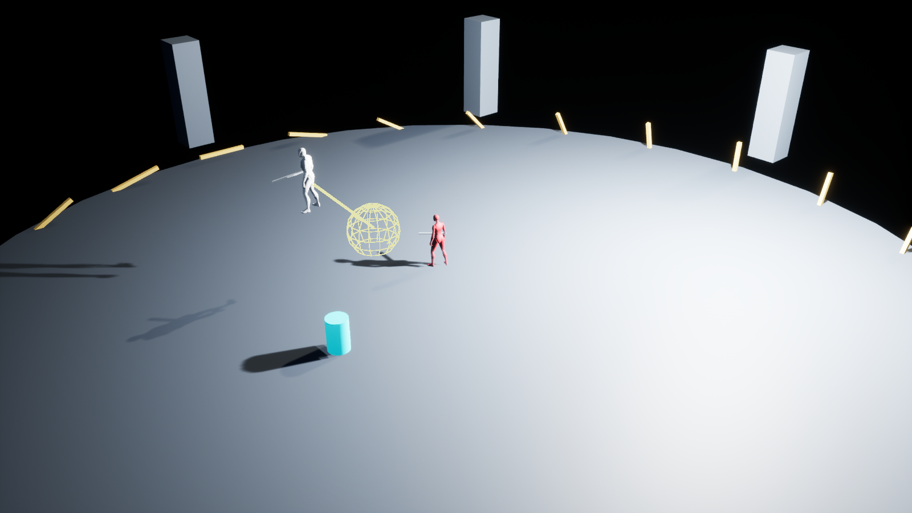

# PBZ-ChiefDisciple-HSM

基于 **Unreal Engine 5.8.4** 的《影之刃零》大师兄 × 红衣女剑客 Boss 战白盒复刻项目。围绕分层状态机（HFSM），完成了资料调研、招式规则整理、动态压力与跨场学习的量化设计、全量状态图，以及可在 UE 中运行的占位角色战斗演示。

项目同时记录了一套 **通过 MCP 操作 UE 编辑器、生成原生蓝图、执行验证并归档交付** 的工作流程，适合研究战斗 AI、状态机设计和 AI 辅助开发。

> 当前交付是逻辑与表现占位的白盒原型。部分规则来自用户观察，缺失参数由本项目设计补全；不代表取得或还原了原作内部源码、完整算法和美术资源。

## 快速入口

| 想了解什么 | 从这里开始 |
|---|---|
| 打开工程、运行演示、测试各阶段 | [BossLab 操作手册](Tools/BossLab/README.md) |
| 浏览完整状态机 | [交互状态图](Research/Step3/Boss全量分层状态机.html) · [SVG 全图](Research/Step3/Boss全量分层状态机.svg) · [设计说明](Research/Step3/README.md) |
| 理解压力、学习和选招概率 | [战斗决策工程规格](Research/Step2/Engineering/战斗决策工程规格.md) · [交互概率检查器](Research/Step2/Engineering/概率检查器.html) |
| 配置 MCP、验证蓝图读写能力 | [Unreal MCP 接入说明](Tools/UnrealMCP/README.md) |
| 阅读完整复盘、原始对话和通用流程 | [项目档案入口](Documentation/影之刃零复刻项目档案_2026-11-13/00_阅读入口.md) |

交互 HTML 需下载到本地后用浏览器打开；GitHub 文件页本身不会运行其中的交互脚本。

## 项目内容

战斗分为四阶段：

| 阶段 | 内容与转换 |
|---|---|
| M1：七星剑阵 | 大师兄与六名弟子协作，包含独立拼刀、组阵、轮攻、吸血与耗血召唤 |
| M2：悬丝形态 | 大师兄被丝线操控，使用有限剑招池、连段变招和近／远距离喷丝；此阶段半血后进入 M3 |
| M3：双 Boss | 红衣剑客加入，大师兄继承 M2 招式并增加双人组合技 |
| M4／终局分支 | 红衣先死则大师兄狂暴；大师兄先死则红衣殉情；狂暴阶段大师兄死亡后结束 |

核心设计与已落地的白盒功能包括：

- **分层状态设计**：生命周期、阶段、角色、行为／资源、动作内部；设计图共 349 个状态／逻辑节点、756 条关系、20 个分区，覆盖 33 个根招式。
- **逐招决策**：资格筛选、距离权重、冷却、重复限制、探索概率和概率封顶；有限连段及合法停招／观察／追加分支。
- **实时压力**：只从本场已结算的玩家操作事件计算，包含去重、衰减和变化预算。
- **跨场学习**：按招式与部分长度／分支记录应对结果，本场冻结历史快照，战斗结算时更新；与实时压力分开。
- **战斗资源与协同**：格挡耗气、破防后回气、坠地与悬吊破防分别计时，剑阵成员打断、单个脱阵槽位和支援请求。
- **白盒演示**：Manny／Quinn 占位角色、通用动画、程序位移与攻击轨迹、移动靶标、阶段与资源测试按键。

## 如何运行

1. 使用 **UE 5.8.4** 打开根目录的 [我的项目.uproject](我的项目.uproject)。工程声明的引擎关联为 5.8，开发与验证使用 5.8.4。
2. 打开关卡 `/Game/BossLab/Maps/L_BossLab`。
3. 按 **Play**，点击游戏画面取得键盘焦点，即可观察自主出招。无需创建或操作主角。

白色角色为大师兄，灰色为六名弟子，红色为红衣剑客，青色圆柱为移动靶标。默认每阶段演示 35 秒，通过明确的演示伤害推进阶段。关闭关卡中 `BossLab_EncounterDirector` 的 `AutoDemo` 可停留在当前阶段。

| 按键 | 用途 |
|---|---|
| `1`～`4` | 重置并进入对应阶段 |
| `B` / `G` | 大师兄破防／坠地 |
| `H` / `T` | 对弟子 1 施加测试攻击／向大师兄发送攻击威胁 |
| `K` / `J` | 击杀红衣／大师兄，测试不同终局分支 |
| `R` / `Space` / `Esc` | 重置／暂停战斗逻辑／结束 PIE |

主蓝图为 `/Game/BossLab/Blueprints/BP_BossEncounter_Final`。打开 **EventGraph** 可查看单页状态总览；详细运行函数、参数和动画接口见 [BossLab 操作手册](Tools/BossLab/README.md)。

**运行已有蓝图不需要 MCP 在线。** MCP 和 Python 用于编辑器期制作、修改与验证；Play 时执行原生 Blueprint 字节码。

## 文件夹说明

以下路径均相对于仓库根目录。`Research` 与 `Tools` 是当前工作材料，`Documentation` 中的“参考附件”是归档时的历史快照。

| 文件夹 | 作用 |
|---|---|
| [Config/](Config/) | UE 工程配置，包括启动地图、输入、项目及编辑器设置 |
| [Content/](Content/) | UE 实际使用的关卡、蓝图、角色、材质等资产，以及编辑器启动 Python 脚本 |
| [Research/](Research/) | 从原作调研到规则、公式、模拟和状态图的设计材料 |
| [Tools/](Tools/) | MCP 桥接、蓝图／场景生成、验证和文档整理工具 |
| [Documentation/](Documentation/) | 完整项目档案、原始对话、原始提示词、复盘与通用流程 |
| `Saved/` | 本地运行日志、截图、备份及构建／测试报告；被 `.gitignore` 忽略，克隆后不保证存在 |
| `Intermediate/` | UE 自动生成的中间文件；被 Git 忽略，不作为源码维护 |
| `DerivedDataCache/` | UE 派生数据缓存；被 Git 忽略，可由引擎重新生成 |
| `.git/` | 本地 Git 版本历史与仓库元数据，不是游戏内容 |

### Content：运行资产

| 子目录 | 作用 |
|---|---|
| [Content/BossLab/Blueprints/](Content/BossLab/Blueprints/) | Boss 战斗主蓝图、无主角观察用 GameMode、学习 SaveGame |
| [Content/BossLab/Maps/](Content/BossLab/Maps/) | 白盒测试地图 `L_BossLab` |
| [Content/BossLab/Materials/](Content/BossLab/Materials/) | 场地、角色区分色、剑和靶标等占位材质 |
| [Content/BossLab/Diagnostics/](Content/BossLab/Diagnostics/) | 蓝图构建辅助层的诊断资产 |
| [Content/MCPDiagnostics/](Content/MCPDiagnostics/) | MCP 创建、连线、编译和执行蓝图的独立探针资产 |
| [Content/Python/](Content/Python/) | 编辑器启动脚本；`init_unreal.py` 开启本机远程 Python，供 MCP 使用 |
| [Content/Characters/](Content/Characters/) | 工程已有 Manny／Quinn 模型、骨架与动画，用于占位表现 |
| [Content/ThirdPerson/](Content/ThirdPerson/) | 保留的第三人称模板资产；BossLab 使用独立 GameMode |
| [Content/Input/](Content/Input/) | 模板输入相关资源 |
| [Content/LevelPrototyping/](Content/LevelPrototyping/) | 模板关卡原型搭建资源 |
| `Content/Collections/`、`Content/Developers/` | 编辑器资产集合／开发者工作区目录，可能为空，不是 Boss 核心逻辑 |
| [Content/__ExternalActors__/](Content/__ExternalActors__/) | UE 外部 Actor 分包数据，归属相应关卡，需与关卡一起管理 |
| [Content/__ExternalObjects__/](Content/__ExternalObjects__/) | UE 外部对象分包数据；由编辑器维护 |

### Research：规则与设计

| 子目录 | 作用 |
|---|---|
| [Research/Step1/](Research/Step1/) | 两名 Boss 的招式、非攻击行为、来源、未知项，以及用户修正后的验收规则 |
| [Research/Step1/sources/](Research/Step1/sources/) | 第一步收集的网页、视频元数据及其他资料缓存 |
| [Research/Step2/](Research/Step2/) | 逆天者动态压力／动态出招调研，区分证据与复刻假设 |
| [Research/Step2/sources/](Research/Step2/sources/) | 第二步采访、社区和视频相关的来源记录 |
| [Research/Step2/Engineering/](Research/Step2/Engineering/) | 可量化的工程规格、逐招参数、Python 参考模型、测试、模拟与交互概率检查器 |
| [Research/Step3/](Research/Step3/) | 全量状态机 JSON、单页 HTML／SVG、状态与转换索引、参数及资源接口、图检查结果 |

`pages_*.json`、`search_*.json` 和 `sources/` 用于资料溯源；它们不是运行时 AI 配置。原始资料与用户确认有冲突时，应结合验收规则及后续工程规格阅读。

### Tools：制作与验证

| 子目录／文件 | 作用 |
|---|---|
| [Tools/UnrealMCP/](Tools/UnrealMCP/) | 本项目本机 MCP 桥接与连接验证 |
| [server.py](Tools/UnrealMCP/server.py) | 提供 `unreal_status`、`unreal_python`、`unreal_run_script`，匹配目标工程并连接 UE |
| [call.py](Tools/UnrealMCP/call.py) | 用真实 MCP stdio 协议执行握手、工具列表和工具调用测试 |
| [probe_blueprint.py](Tools/UnrealMCP/probe_blueprint.py) | 创建独立诊断蓝图，验证变量、函数、节点、连线、编译、执行与保存 |
| [check_runtime_api.py](Tools/UnrealMCP/check_runtime_api.py) | 探测本机 UE 运行／编辑 API 能力 |
| [Tools/BossLab/](Tools/BossLab/) | Boss 白盒的构建、测试与归档工具 |
| [bp_dsl.py](Tools/BossLab/bp_dsl.py) | 蓝图节点和引脚的生成辅助层；不是游戏运行时依赖 |
| [build_runtime.py](Tools/BossLab/build_runtime.py) | 生成 Boss 运行蓝图、单页状态总览和命名动画接口 |
| [build_scene.py](Tools/BossLab/build_scene.py) | 创建测试场景、占位角色、靶标、相机并绑定蓝图实例 |
| [verify_runtime.py](Tools/BossLab/verify_runtime.py) | 在 PIE 中直接调用蓝图函数，检查阶段、概率、资源、连段与结局 |
| [verify_learning.py](Tools/BossLab/verify_learning.py) | 在 PIE 中检查历史学习、样本归档与剑阵顺序 |
| [probe_builder.py](Tools/BossLab/probe_builder.py) | 蓝图生成辅助层的最小诊断脚本 |
| [archive_narrative.md](Tools/BossLab/archive_narrative.md) | 项目复盘、MCP 过程和通用工作流的归档正文源稿 |
| [build_archive.py](Tools/BossLab/build_archive.py) | 从指定本地会话提取原始对话并生成档案；依赖作者本机的会话记录 |
| [review_archive.mjs](Tools/BossLab/review_archive.mjs) | 使用本机 Edge 检查档案 HTML、生成 PDF 和预览；依赖 Node.js 与浏览器路径 |

### Documentation：项目档案

档案目录：[影之刃零复刻项目档案_2026-11-13](Documentation/影之刃零复刻项目档案_2026-11-13/)。

| 子目录／材料 | 作用 |
|---|---|
| 总文档 `.md / .html / .docx / .pdf` | 同一份完整复盘的不同阅读格式，包含 MCP 配置排错、复刻过程、通用流程与原始对话附录 |
| `原始记录/` | 对话和用户提示词的结构化 JSON，保留时间、来源行与文本校验值 |
| `配置快照/` | 归档时的 `unreal_project` MCP 服务段和来源说明；不是迁移后自动生效的配置 |
| `参考附件/` | 归档时调研、设计、脚本和测试报告的副本，按原工程相对路径组织 |
| `图片/` | 用户原始参考图、状态机概览、UE 运行画面及文档预览 |
| `归档说明.json`、`参考附件索引.json` | 说明提取范围、记录数量及附件来源 |
| `文档校验报告.json`、`浏览器校验报告.json`、`文件校验清单.json` | 原文一致性、浏览器功能检查和文件哈希 |

归档包含 **17 条用户提示词／确认消息、59 条助手回复、2 条可见交互问题，共 78 条记录**。原文与后续总结分别保存；归档中的旧路径和当时判断保留其历史含义。

## 重要文档与推荐阅读顺序

| 顺序 | 文档 | 解决的问题 |
|---|---|---|
| 1 | [Boss 战第一步调研](Research/Step1/Boss战第一步调研.md) | 有哪些招式、颜色、基础动作与来源，哪些仍是未知项 |
| 2 | [第一步验收规则](Research/Step1/第一步验收规则.md) | 用户最终确认的 20 条规则；包括无闪避无敌帧、只破防回气等硬约束 |
| 3 | [逆天者动态压力与出招机制调研](Research/Step2/逆天者动态压力与出招机制调研.md) | 公开证据支持哪些机制，哪些不能当作原作事实 |
| 4 | [战斗决策工程规格](Research/Step2/Engineering/战斗决策工程规格.md) | 压力、跨场学习、逐招权重、事件归因、时序与异常处理的完整设计 |
| 5 | [逐招参数与概率表](Research/Step2/Engineering/逐招参数与概率表.md) | 33 个根招式的默认参数、连段模板和概率示例 |
| 6 | [模拟与核对报告](Research/Step2/Engineering/模拟与核对报告.md) | 参考模型测了什么、统计结果和局限 |
| 7 | [第三步设计说明](Research/Step3/README.md) | 如何浏览状态图，层级、并行服务和连线类型如何理解 |
| 8 | [全部状态与条件索引](Research/Step3/全部状态与条件索引.md) | 按 StateID 查状态、层级与出口条件 |
| 9 | [全部状态转换 CSV](Research/Step3/全部状态转换.csv) | 逐条查看起终点、守卫、类型、优先级和副作用 |
| 10 | [BossLab 操作手册](Tools/BossLab/README.md) | 当前 UE 实现如何运行、调参、接动画，以及有哪些实现边界 |
| 11 | [完整项目档案](Documentation/影之刃零复刻项目档案_2026-11-13/影之刃零复刻项目完整记录与通用流程.md) | 从 MCP 接入到白盒交付的完整历史和可复用流程 |
| 12 | [用户原始提示词](Documentation/影之刃零复刻项目档案_2026-11-13/用户原始提示词.md) · [原始对话](Documentation/影之刃零复刻项目档案_2026-11-13/原始对话.md) | 查看需求、修正、验收和当时回复的原文 |

机器可读设计数据：

- [move_catalog.json](Research/Step2/Engineering/move_catalog.json)：规范招式、别名、禁用项和基础参数。
- [fsm_graph.json](Research/Step3/fsm_graph.json)：状态／关系、布局、层级与招式映射，是可视化图的数据源。
- [parameter_interfaces.json](Research/Step3/parameter_interfaces.json)：状态机设计中的参数接口和默认值。
- [asset_bindings.json](Research/Step3/asset_bindings.json)：动画、碰撞、特效、音效等命名接口；缺失资源以空引用表示。

## MCP 接入与工程迁移

制作链路为 `Codex → stdio MCP → UE 本机远程 Python → 蓝图编辑 API`。接入、启动脚本报错及最小验证见 [Unreal MCP README](Tools/UnrealMCP/README.md) 和完整档案。

工程移动到本 Git 仓库后，**MCP 客户端原有配置不会自动跟随文件夹移动**：

- 将服务 `args` 中的 `server.py` 路径更新为新仓库下的 `Tools/UnrealMCP/server.py`。
- 将 `--project` 更新为包含 `我的项目.uproject` 的新仓库根目录；不要填 `.git` 目录。
- Python 解释器和 `--engine` 指向本机实际 UE 安装位置；只有引擎位置变化才需相应调整。
- 打开新位置的工程，确认 `Content/Python/init_unreal.py` 已执行，再用 `unreal_status` 检查返回的 `project_root`。

归档配置和原始对话中的旧绝对路径是历史记录。此 README 使用仓库相对链接，便于迁移和 GitHub 阅读。归档生成工具还包含作者本机的会话／浏览器路径，重新生成前需要自行配置。

## 验证结果

以下是开发阶段已保存的结果，不代表每次克隆或阅读 README 时重新执行测试。

| 层级 | 结果 | 报告 |
|---|---|---|
| MCP 蓝图读写 | 输入 321、返回 321、成员变量 321；编译保存成功 | [蓝图探针报告快照](Documentation/影之刃零复刻项目档案_2026-11-13/参考附件/Saved/UnrealMCP/blueprint_probe.json) |
| Python 决策参考模型 | 25 项单测通过，100,000 个随机上下文未发现已检查的概率约束违规 | [模拟结果](Research/Step2/Engineering/simulation_results.json) |
| 状态图 | 结构与浏览器检查结果分别保存 | [结构检查](Research/Step3/graph_audit.json) · [浏览器检查](Research/Step3/browser_review.json) |
| UE 原生蓝图运行 | 32 / 32 项通过 | [运行验证报告快照](Documentation/影之刃零复刻项目档案_2026-11-13/参考附件/Saved/BossImplementation/runtime_verification.json) |
| UE 学习与剑阵 | 11 / 11 项通过 | [学习验证报告快照](Documentation/影之刃零复刻项目档案_2026-11-13/参考附件/Saved/BossImplementation/learning_verification.json) |

共 **43 项 UE 检查**。实际执行后报告写入本地 `Saved/`；该目录被 Git 忽略，所以这里链接到已归档的报告副本。离线模型测试、图结构检查和 UE 运行检查各有覆盖范围，不能互相替代。

## 当前范围与后续工作

- **单页总览不等于全部转换均可直接编辑执行**：756 条关系包含状态流、数据、事件和继承关系；Guard 是说明文本，实际条件和状态推进在蓝图函数中执行，单改说明文字不会改逻辑。
- **双 Boss 协同仍为简化实现**：目前统一主攻队列轮换并执行双人组合技；独立副攻预约日历、完整角色避障等仍待落地。
- **动作表现为占位**：使用工程已有 Epic Manny／Quinn 与通用动画，不是原作动作；专用剑招、阵型踏步、悬丝及死亡演出仍需资源。
- **尚未接入完整玩家战斗与碰撞**：当前依靠靶标、接口和测试事件观察逻辑；真实 Hitbox、动画 Notify、精确威胁判断与逐分支采样仍需继续实现。
- **未完成打包和真实玩家体验验证**：已通过的测试只证明各报告中的用例，不代表原设计全部细节均已完成。

后续建议按“设计条目 → 执行函数 → UE 验证用例 → 表现资源”逐项补齐。完整差异、经验总结与通用提示词模板见 [项目档案](Documentation/影之刃零复刻项目档案_2026-11-13/影之刃零复刻项目完整记录与通用流程.md)。
